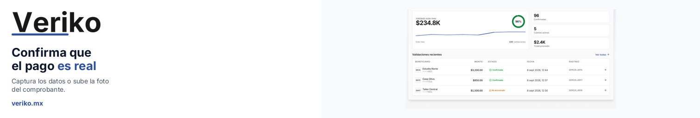
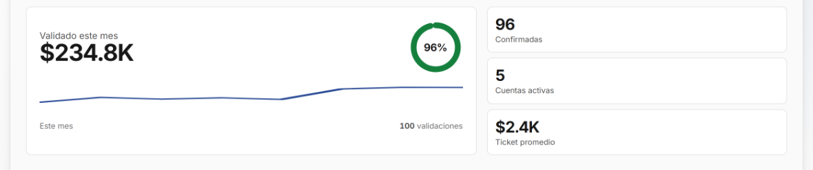

<p align="center">
  <picture>
  <source media="(prefers-color-scheme: dark)" srcset="hero-dark.png">
  
</picture>
</p>

# Veriko

**Confirma que el pago fue acreditado.** Verificación de transferencias SPEI en Banxico.

Veriko rastrea transferencias SPEI y obtiene el CEP de Banxico, todo en segundos. Sube la foto del comprobante o escribe los datos del pago: clave de rastreo, cuenta, fecha y monto. En segundos sabes si el dinero de verdad se movió, sin llamar al banco.

<p align="center">
              
</p>


[Sitio](https://veriko.mx) · [Documentación](https://docs.veriko.mx) · [Guías](https://veriko.mx/resources) · [Seguridad](https://veriko.mx/security)

## Valida en una sola llamada

Para integrar, la API valida transferencias SPEI en Banxico en una sola llamada, con webhooks firmados y reintentos. Ejemplos en cURL, Node, Python, PHP y Go.

```bash
curl -X POST https://api.veriko.mx/v1/validate \
  -H "Authorization: Bearer veriko_TU_CLAVE" \
  -H "Content-Type: application/json" \
  -d '{
    "send_date": "2025-03-15",
    "amount": 15000.50,
    "tracking_key": "MXBA20250315001234",
    "sender_bank": "40012",
    "beneficiary_account": "012180004412345678"
  }'
```

La respuesta trae el veredicto y, si el pago fue acreditado, el enlace al CEP oficial en PDF. Los datos del ejemplo son de ejemplo; usa los de una transferencia real. También hay validación por foto del comprobante (OCR), modo asíncrono y validación en lote. [Ejemplos en cURL, Node, Python y PHP](https://github.com/veriko-mx-labs/examples)

## SDK

| Repositorio | Qué es |
| --- | --- |
| [veriko-python](https://github.com/veriko-mx-labs/veriko-python) | SDK de Python. Paquete [`veriko` 0.8.1](https://pypi.org/project/veriko/) en PyPI. |
| [veriko-js](https://github.com/veriko-mx-labs/veriko-js) | SDK de JavaScript y TypeScript. Paquete [`@veriko-mx/sdk` 0.6.1](https://www.npmjs.com/package/@veriko-mx/sdk) en npm. |
| [veriko-mcp](https://github.com/veriko-mx-labs/veriko-mcp) | Servidor MCP. Paquete [`@veriko-mx/mcp` 0.2.4](https://www.npmjs.com/package/@veriko-mx/mcp) en npm. |
| [examples](https://github.com/veriko-mx-labs/examples) | Ejemplos en cURL, Node, Python y PHP. |
| [veriko-api-collection](https://github.com/veriko-mx-labs/veriko-api-collection) | Colección de peticiones para Bruno. |

## Cómo funciona

| Sube una imagen | Validación en Banxico | Obtienes el comprobante (CEP) |
| --- | --- | --- |
| O ingresa manualmente los datos del pago. | Consultamos la validez del pago en el sistema bancario. | Si el pago fue acreditado, obtienes el comprobante oficial. Si no, te avisamos de inmediato. |

## La prueba

<p align="center">
  
</p>

El Comprobante Electrónico de Pago (CEP) es emitido por el Banco de México y avala una transferencia SPEI liquidada correctamente. Validación en el sistema bancario en **10 segundos**. Documento oficial en PDF / XML.

## También desde la Web/App

Sin instalar nada: sube tus pagos, revisa tus finanzas y operaciones desde un solo lugar. Panel, reportes y alertas, carga masiva y varias cuentas y vendedores. [Abrir el panel](https://app.veriko.mx)

## Contacto

| Canal | Contacto |
| --- | --- |
| WhatsApp | [+52 220 589 9701](https://wa.me/522205899701) (ventas y soporte) |
| Facebook | [Veriko MX](https://www.facebook.com/veriko.mx) |
| Instagram | [@veriko.mx](https://www.instagram.com/veriko.mx) |
| Correo | [soporte@veriko.mx](mailto:soporte@veriko.mx) |
| Teléfono | [+52 220 589 9701](tel:+522205899701) |

## Sin compartir credenciales bancarias.

La CLABE, el monto y la clave de rastreo permiten localizar el CEP en Banco de México, pero no dan acceso a tu cuenta bancaria. No es necesario proporcionar contraseñas, NIPs o tokens bancarios.

## Empieza gratis.

Plan gratis con acceso al sistema completo, paga cuando necesites más validaciones. [Ver planes](https://veriko.mx/precios)

## Empieza a validar tus pagos hoy.

Crea tu cuenta y confirma tu primer pago en minutos. [veriko.mx](https://veriko.mx)
